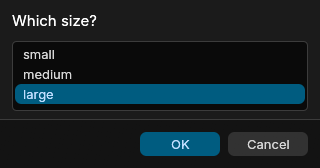

<div align="center">

# PWRS-GUI

**Windows, dialogs, grids and pages of your own for PowerShell, drawn on the GPU or in the system's webview by Rust renderers, for Windows PowerShell 5.1 and PowerShell 7, built with PoWerRuSt.**

[](LICENSE)
[](https://learn.microsoft.com/powershell/)

**[Wiki](https://variably-constant.github.io/PWRS-GUI/)** | [Getting started](https://variably-constant.github.io/PWRS-GUI/docs/tutorials/getting-started/) | [Reference](https://variably-constant.github.io/PWRS-GUI/docs/reference/)

`Read-GuiChoice`, `Read-GuiInput` and `Read-GuiCredential` ask in a window, `Show-GuiMessage`, `Read-GuiFile`, `Read-GuiSavePath` and `Read-GuiFolder` ask through the system's own dialogs, `Out-GuiGridView` shows objects in a grid to pick from, `Show-GuiProgress` shows a script's progress, `Show-GuiWindow` shows a window of widgets or a page of your own, and the other commands talk to pages and find, drive and capture the windows and dialogs a session has open. A helper process draws them with egui on wgpu or in WebView2, WebKit or WebKitGTK, or on Windows PowerShell's own process does. Built with [PoWerRuSt](https://github.com/Variably-Constant/PWRS).

</div>

---

<details>
<summary><b>Table of contents</b></summary>

- [Features](#features)
- [Quick start](#quick-start)
- [Why](#why)
- [Commands](#commands)
- [Tested platforms](#tested-platforms)
- [Building from source](#building-from-source)
- [Repository layout](#repository-layout)
- [Wiki](#wiki)
- [Use of AI tools](#use-of-ai-tools)
- [License](#license)
- [Contributing](#contributing)

</details>

---

## Features

- [A choice from a list](https://variably-constant.github.io/PWRS-GUI/docs/how-to/how-to-ask-for-a-choice/), one or several, each labeled as Format-Wide labels it or by `-Property`, and nothing written when the window is canceled.
- [Objects in a grid](https://variably-constant.github.io/PWRS-GUI/docs/how-to/how-to-show-objects-in-a-grid/) that sorts by any column and filters as you type, with Out-GridView's `-PassThru`, `-OutputMode` and `-Wait`, the picked objects written back as they were piped.
- [Windows described in PowerShell](https://variably-constant.github.io/PWRS-GUI/docs/tutorials/a-window-of-your-own/) from [38 widgets](https://variably-constant.github.io/PWRS-GUI/docs/reference/#widgets), tables, trees, charts, menus, a canvas and a GPU surface among them, drawn by egui or in a webview.
- [A canvas](https://variably-constant.github.io/PWRS-GUI/docs/reference/new-guicanvas/) of shapes, text and pictures with events, animations and a view that pans and zooms, which another process changes through a SubEtha ring or [shared memory](https://variably-constant.github.io/PWRS-GUI/docs/how-to/how-to-move-canvas-items-from-shared-memory/).
- [Handlers](https://variably-constant.github.io/PWRS-GUI/docs/how-to/how-to-act-on-events/) that change a window as a person uses it, and [windows that stay open](https://variably-constant.github.io/PWRS-GUI/docs/how-to/how-to-show-progress-from-a-script/) while a script updates them.
- [Pages of your own](https://variably-constant.github.io/PWRS-GUI/docs/how-to/how-to-show-a-page/) from HTML or a folder, talking to PowerShell both ways and brought back when their engine crashes, with [web data](https://variably-constant.github.io/PWRS-GUI/docs/explanation/web-page-data-and-recovery/) shared between processes or kept apart.
- [Pages on Linux and FreeBSD without WebKitGTK installed](https://variably-constant.github.io/PWRS-GUI/docs/explanation/the-webkitgtk-add-on/), from an add-on module that ships it with its source beside it, and drawn in software when the GPU cannot start EGL.
- [Windows a test drives](https://variably-constant.github.io/PWRS-GUI/docs/how-to/how-to-test-a-window/) as a person would, and reads back as widgets, their state and their pixels.
- [Drawing on the GPU](https://variably-constant.github.io/PWRS-GUI/docs/how-to/how-to-choose-where-windows-are-drawn/) through DirectX 12, Vulkan or OpenGL, or Microsoft's WARP where there is no GPU, or [in the system's webview](https://variably-constant.github.io/PWRS-GUI/docs/how-to/how-to-choose-where-windows-are-drawn/#draw-widget-windows-in-a-webview).
- [A helper process draws by default](https://variably-constant.github.io/PWRS-GUI/docs/explanation/where-windows-are-drawn/); on Windows, PowerShell's own process can draw instead.
- [Waits that sleep](https://variably-constant.github.io/PWRS-GUI/docs/explanation/events-and-waiting/) until an event, Ctrl+C or the renderer's end.
- [One renderer per process](https://variably-constant.github.io/PWRS-GUI/docs/explanation/sharing-the-renderers/), shared by every runspace and, [through a native entry](https://variably-constant.github.io/PWRS-GUI/docs/how-to/how-to-share-the-session-with-another-module/), by other Rust modules.
- [The same windows from a Rust program](https://variably-constant.github.io/PWRS-GUI/docs/how-to/how-to-open-windows-from-rust/), with no PowerShell involved.
- [Latency measured on your machine](https://variably-constant.github.io/PWRS-GUI/docs/how-to/how-to-measure-latency/), from a click to the module, a handler, the pipeline and an engine-event action.
- [Every failure](https://variably-constant.github.io/PWRS-GUI/docs/reference/error-reference/) an error record with an id of its own.

## Quick start

Install the module from the PowerShell Gallery, or build it as [Building from source](#building-from-source) shows:

```powershell
Install-Module PWRS-GUI -Scope CurrentUser
```

Then ask a question in a window:

```powershell
$size = Read-GuiChoice -Prompt 'Which size?' -Choice 'small', 'medium', 'large'
"You chose $size"
```

A window opens with the three choices. Pick one and press OK:

```text
You chose large
```



The wiki's [Getting Started](https://variably-constant.github.io/PWRS-GUI/docs/tutorials/getting-started/) begins LogLens, a log viewer its tutorial builds over eleven chapters, by picking a log in the system's file dialog and showing its lines in a grid; [A Window Of Your Own](https://variably-constant.github.io/PWRS-GUI/docs/tutorials/a-window-of-your-own/) goes on to windows of your own. Its how-to guides cover testing a window, screenshots and other modules sharing the session.

## Why

PowerShell's own windows stop at Windows. Microsoft's reference says Out-GridView "is only available on Windows systems that support the Windows Desktop"; `Read-Host` and `$Host.UI.PromptForChoice` ask in the console; Windows Forms and WPF, loaded with `Add-Type`, build any window on Windows, from a thread the script sets up for them. None comes with commands a test can drive and read the windows with.

PWRS-GUI gives both hosts the same commands, draws on the GPU in a process of its own or PowerShell's, and lets a script or a test reach every window a session has open. The wiki's [Why PWRS-GUI](https://variably-constant.github.io/PWRS-GUI/docs/explanation/why-pwrs-gui/) has the comparison and its sources.

## Commands

| Command | Takes | Writes |
|---|---|---|
| [`Read-GuiChoice`](https://variably-constant.github.io/PWRS-GUI/docs/reference/read-guichoice/) | `-Choice` objects, `-Prompt`, `-Default`, `-Multiple`, `-Title`, `-Property` | the chosen objects as given; nothing when canceled |
| [`Out-GuiGridView`](https://variably-constant.github.io/PWRS-GUI/docs/reference/out-guigridview/) | piped objects, `-Title`, and `-PassThru`, `-Wait` or `-OutputMode` | with `-PassThru` or `-OutputMode Single` or `Multiple`, the chosen objects as piped; otherwise nothing |
| [`Read-GuiInput`](https://variably-constant.github.io/PWRS-GUI/docs/reference/read-guiinput/) | `-Field` hashtables, `-Prompt`, `-Title` | `PSCustomObject` of the fields' values; nothing when canceled |
| [`Read-GuiCredential`](https://variably-constant.github.io/PWRS-GUI/docs/reference/read-guicredential/) | `-Message`, `-UserName`, `-Title` | `PSCredential`; nothing when canceled |
| [`Show-GuiMessage`](https://variably-constant.github.io/PWRS-GUI/docs/reference/show-guimessage/) | `-Message`, `-Title`, `-Icon`, `-Buttons` | `PwrsGui.MessageResult`, the button pressed |
| [`Read-GuiFile`](https://variably-constant.github.io/PWRS-GUI/docs/reference/read-guifile/) | `-Filter`, `-Multiple`, `-InitialDirectory`, `-Title` | the paths chosen; nothing when canceled |
| [`Read-GuiSavePath`](https://variably-constant.github.io/PWRS-GUI/docs/reference/read-guisavepath/) | `-Filter`, `-FileName`, `-InitialDirectory`, `-Title` | the path chosen; nothing when canceled |
| [`Read-GuiFolder`](https://variably-constant.github.io/PWRS-GUI/docs/reference/read-guifolder/) | `-InitialDirectory`, `-Title` | the path chosen; nothing when canceled |
| [`Show-GuiProgress`](https://variably-constant.github.io/PWRS-GUI/docs/reference/show-guiprogress/) | `-Activity`, `-Status`, `-PercentComplete`, `-Ring`, `-Title` | `PwrsGui.ProgressWindow`, with its `State` |
| [`Set-GuiProgress`](https://variably-constant.github.io/PWRS-GUI/docs/reference/set-guiprogress/) | `-Window`, `-Status`, `-Activity`, `-PercentComplete`, `-Completed` | nothing |
| [`Show-GuiWindow`](https://variably-constant.github.io/PWRS-GUI/docs/reference/show-guiwindow/) | `-Content` widgets, or `-Html` or `-Path`; `-Title`, `-Width`, `-Height`, `-Renderer`, `-HandlerOutput`, `-OnClose`, `-OnShortcut`, `-OnDrop`, `-WatchPath`, `-WatchInterval`, `-OnFileChange`, `-OnMessage`, `-AllowNavigation`, `-DevTools`, `-NoWait` | `PwrsGui.WindowResult` with the window's result and its inputs' state; with `-NoWait`, `PwrsGui.Window` or `PwrsGui.PageWindow` |
| [`New-Gui<Widget>`](https://variably-constant.github.io/PWRS-GUI/docs/reference/#widgets), 38 of them | each widget's own parameters and `-On` handlers | `PwrsGui.Widget`, for a `-Content` block |
| [`Wait-GuiEvent`](https://variably-constant.github.io/PWRS-GUI/docs/reference/wait-guievent/) | `-Window`, `-Name`, `-Timeout` | `PwrsGui.WidgetEvent`, the next event of a `-NoWait` window |
| [`Update-GuiWidget`](https://variably-constant.github.io/PWRS-GUI/docs/reference/update-guiwidget/) | `-Window`, `-Name`, `-Property` | nothing |
| [`Add-GuiItem`](https://variably-constant.github.io/PWRS-GUI/docs/reference/add-guiitem/) | `-Window`, `-Name`, `-Item`, `-Parent` | nothing |
| [`Remove-GuiItem`](https://variably-constant.github.io/PWRS-GUI/docs/reference/remove-guiitem/) | `-Window`, `-Name`, `-Item` | nothing |
| [`Set-GuiFocus`](https://variably-constant.github.io/PWRS-GUI/docs/reference/set-guifocus/) | `-Window`, `-Name` | nothing |
| [`Close-GuiWindow`](https://variably-constant.github.io/PWRS-GUI/docs/reference/close-guiwindow/) | `-Window`, `-Result` | nothing |
| [`Send-GuiMessage`](https://variably-constant.github.io/PWRS-GUI/docs/reference/send-guimessage/) | `-Window`, `-Message` | nothing |
| [`Get-GuiWindow`](https://variably-constant.github.io/PWRS-GUI/docs/reference/get-guiwindow/) | `-Title` | `PwrsGui.Window`, one per open window |
| [`Get-GuiDialog`](https://variably-constant.github.io/PWRS-GUI/docs/reference/get-guidialog/) | `-Title` | `PwrsGui.Dialog`, one per open dialog |
| [`Invoke-GuiTestEvent`](https://variably-constant.github.io/PWRS-GUI/docs/reference/invoke-guitestevent/) | `-Window`, `-Name`, `-Event`, `-Value`, or `-Shortcut` or `-Drop`; or `-Dialog` and `-Value`; `-PassThru` | with `-PassThru`, the value the widget took |
| [`Get-GuiSnapshot`](https://variably-constant.github.io/PWRS-GUI/docs/reference/get-guisnapshot/) | `-Window`, `-Pixels`, `-Name` | `PwrsGui.Snapshot` |
| [`Set-GuiOption`](https://variably-constant.github.io/PWRS-GUI/docs/reference/set-guioption/) | `-Mode`, `-Renderer`, `-Theme`, `-Font`, `-Adapter`, `-LowPower`, `-WebView`, `-WebViewDataFolder` | nothing |
| [`Get-GuiOption`](https://variably-constant.github.io/PWRS-GUI/docs/reference/get-guioption/) | nothing | `PwrsGui.Option` |
| [`Measure-GuiLatency`](https://variably-constant.github.io/PWRS-GUI/docs/reference/measure-guilatency/) | `-Count`, `-NoWait` | `PwrsGui.Latency`, one per click; with `-NoWait`, a run whose clicks an engine-event action times |
| [`Get-GuiNativeEntry`](https://variably-constant.github.io/PWRS-GUI/docs/reference/get-guinativeentry/) | nothing | `PwrsGui.NativeEntry` |
| [The GPU commands](https://variably-constant.github.io/PWRS-GUI/docs/reference/#gpu), 19 of them | arrays, images or lengths; WGSL; a GpuSurface's draws and camera | `PwrsGui.GpuAdapter`, `PwrsGui.GpuBuffer`, `PwrsGui.GpuTexture`, `PwrsGui.GpuSampler`, `PwrsGui.GpuRenderPipeline` and `PwrsGui.GpuCamera`; arrays read back, and a compute run's arrays or `PwrsGui.ComputeResult` |
| [The canvas view commands](https://variably-constant.github.io/PWRS-GUI/docs/reference/#canvas), 3 of them | `-Window`, `-Name`, and a view's center, zoom, fit and controls | `PwrsGui.CanvasView` from `Get-GuiCanvasView`; otherwise nothing |

Each reference page lists every parameter as the binder sees it and every property of the output types, with output from both hosts; the [Error Reference](https://variably-constant.github.io/PWRS-GUI/docs/reference/error-reference/) lists every error id.

## Tested platforms

| Platform | System | PowerShell | Result |
|---|---|---|---|
| Windows x64 | Windows 11 Pro 10.0.26200, GeForce RTX 5070, Radeon graphics and WARP, WebView2 154 | 7.6.6 and 5.1 | 505 Pester tests in each host, every suite in Helper and in-process mode |
| Windows Server x64 | Windows Server 2019, AppLocker's default rules, a standard user | 7.6.6 and 5.1 | the helper refused, so Auto mode drew in PowerShell's process in each host; with no WebView2, HTML dialogs drawn with egui |
| Linux x64 | Ubuntu 24.04 under Xvfb, Mesa's llvmpipe, WebKitGTK 2.52.6 | 7.6.6 | 285 Pester tests, Helper mode |
| FreeBSD x64 | FreeBSD 15.0 under Xvfb, Mesa's llvmpipe, WebKitGTK 2.46.6 | 7.5.5 | 285 Pester tests, Helper mode |
| macOS arm64 | GitHub's hosted runners, macOS 26.6.2 and 14.8.9, the system's WebKit | 7.6.5 and 7.6.4 | 271 Pester tests on each, Helper mode |

On the Windows machine a click reached the pipeline in a median 63 to 130 µs, Ctrl+C returned a waiting command in a median 0.3 to 0.9 ms, a page whose WebView2 browser process was killed was back in a median 216 ms, and a new egui helper answered the next command after about 0.5 s. A dialog came to the front from the classic console and from Windows Terminal, drawn by a helper or in PowerShell's own process, and so did a session's second dialog, the terminal having the front back once the first had closed. The module folder is 55.3 MB on Windows, 41.7 to 42.1 MB on Linux and FreeBSD, and 28.9 MB on macOS. The wiki's [Tested Platforms](https://variably-constant.github.io/PWRS-GUI/docs/reference/tested-platforms/) has every run, the measurements, and what has not been run.

## Building from source

The workspace builds on three source trees beside the checkout. PWRS's, `../pwrs`, gives it the PoWerRuSt of PWRS's next release before that is published. SubEtha's, `../SubEtha`, gives it `subetha-cxc`, since it needs `BlockingAdaptiveRing`, which no published SubEtha release carries yet. The Wgpu module's, `../Wgpu`, gives it the `wgpu-pwsh` crate and the `wgpu-core` it vendors. cargo-pwrs embeds the runtime of the PoWerRuSt it is built with, so it is built from PWRS's tree as well. It needs Rust 1.99 or later, with the MSVC toolchain on Windows, PowerShell 7.4 or later on `PATH`, and on Linux and FreeBSD WebKitGTK 4.1's development files:

```text
pwsh -File patches/apply.ps1
cargo install --path ../pwrs/crates/cargo-pwrs --root target/tools --locked
target/tools/bin/cargo-pwrs pwrs build --release --manifest-dir crates/pwrs-gui
target/tools/bin/cargo-pwrs pwrs test --release --manifest-dir crates/pwrs-gui
```

`patches/apply.ps1` unpacks the six crates the workspace patches, eframe, egui-wgpu, winit, tao, epaint and rfd, from crates.io into `patched/` and applies each one's patch; cargo cannot load the workspace until it has run. The module folder is `target/pwrs/PWRS-GUI`. The wiki's [Building From Source](https://variably-constant.github.io/PWRS-GUI/docs/building/building-from-source/) lists what the build needs and what the folder holds, and how `pwrs-gui-addons` builds the WebKitGTK, Mesa and WebView2 add-ons; [How To Run The Tests](https://variably-constant.github.io/PWRS-GUI/docs/building/how-to-run-the-tests/) every test layer.

## Repository layout

| Path | Role |
|---|---|
| `crates/pwrs-gui-proto` | the messages between a session and its renderers, the window tree they describe, and the SubEtha rings that carry them between processes |
| `crates/pwrs-gui-fonts` | the fonts both renderers draw text in, Inter and JetBrains Mono NL, as their releases ship them, with their SIL Open Font License texts |
| `crates/pwrs-gui-client` | a session for any Rust program: starts the renderer, opens windows and waits on them, with no PowerShell involved; `examples/` opens a window from a plain program and times a renderer's start |
| `crates/pwrs-gui-egui` | the egui renderer: egui on wgpu, each window a viewport of its own |
| `crates/pwrs-gui-gpu` | the GPU layer: the egui renderer's device as the Wgpu module's library takes it, the buffers, textures, samplers and render pipelines a session makes on it, and the plans GPU surfaces draw from them |
| `crates/pwrs-gui-web` | the HTML renderer: tao windows holding wry webviews, the widget runtime that draws a window tree in a page, pages of your own and their bridge, and where webviews keep their data |
| `crates/pwrs-gui-dialogs` | the system's own dialogs both renderers show, each kept by its request while it is open so a stopped command or a test closes it the platform's own way |
| `crates/pwrs-gui` | the PWRS module and its 86 commands, and the two helper executables; `tests/` holds the Pester suites `cargo pwrs test` runs in both hosts |
| `crates/pwrs-gui-standin` | a module that draws through PWRS-GUI's session by its native entry, built for the tests |
| `crates/pwrs-gui-addons` | the tool that builds the add-on modules: WebKitGTK's from Ubuntu's and FreeBSD's own packages, with the corresponding source their licenses ask for; Mesa's for Windows from Mesa's and LLVM's source; and WebView2's, whose command fetches Microsoft's Fixed Version runtime |
| `patches` | the patches the workspace applies to six crates.io crates, eframe, egui-wgpu, winit, tao, epaint and rfd, and `apply.ps1`, which unpacks each crate into `patched/` and applies its patch |
| `wiki/content/docs` | the documentation, organized by the Diataxis framework: a tutorial, how-to guides, explanations and reference pages, and a section on building and testing |
| `wiki/hugo.yaml`, `wiki/go.mod`, `wiki/go.sum`, `wiki/layouts`, `wiki/i18n`, `wiki/static` | the Hugo site the wiki is published as, on the Hextra theme |
| `.cargo/config.toml` | the x86-64 baseline for every build, and the static C runtime on Windows |
| `.github/workflows/ci.yml` | CI on GitHub's macOS arm64 runner: clippy, the Rust tests, the stand-in, `cargo pwrs test` and a publish dry run |
| `.github/workflows/wiki-deploy.yml` | builds the wiki with Hugo and publishes it to GitHub Pages at every push to main |
| `Cargo.toml`, `Cargo.lock` | the workspace and the exact versions every build compiles |
| `LICENSE` | MIT |

## Wiki

The documentation is published at [variably-constant.github.io/PWRS-GUI](https://variably-constant.github.io/PWRS-GUI/), built from [`wiki/content`](wiki/content) by the Diataxis framework: a tutorial in eleven chapters, fourteen how-to guides, nine explanations, 90 reference pages (one for each of the 86 commands, the native entry's functions, the environment variables, the error ids, and the tested platforms), and two pages on building from source and running the tests. Every PowerShell example on them ran in both hosts, with the output it printed.

## Use of AI tools

The author used Claude (Anthropic) via the Claude Code CLI for code development assistance, documentation drafting and test scripting during the preparation of this repository. All design decisions and the final content were determined by the author. The Rust implementation, the unit tests and the Pester suites were verified through zero-warning `cargo clippy` passes, `cargo pwrs test` in PowerShell 7 and Windows PowerShell 5.1, and runs of the built module on Windows, Linux and FreeBSD.

## License

MIT, in [LICENSE](LICENSE). The renderers draw text in Inter and JetBrains Mono NL, under OFL-1.1, then in the system's fonts for characters those lack, and last in egui's own fonts, under OFL-1.1 and Ubuntu-font-1.0. Beyond cargo-pwrs's permissive defaults, `crates/pwrs-gui/Cargo.toml` allows those two licenses by name, and MPL-2.0 for option-ext, which wry links on Linux, the BSDs and macOS. cargo-pwrs writes the notices the module carries into its folder: `THIRD-PARTY-NOTICES.txt` at the root, for the assemblies PWRS compiles, and one under each `runtimes/<rid>`, with the license and license files of each crate compiled into that platform's library and helper.

## Contributing

Issues and pull requests go to [github.com/Variably-Constant/PWRS-GUI](https://github.com/Variably-Constant/PWRS-GUI). A change keeps `cargo clippy --workspace --all-targets -- -D warnings` clean and `cargo pwrs test` passing in both hosts, and an example added to the wiki shows the output it gave in both.
