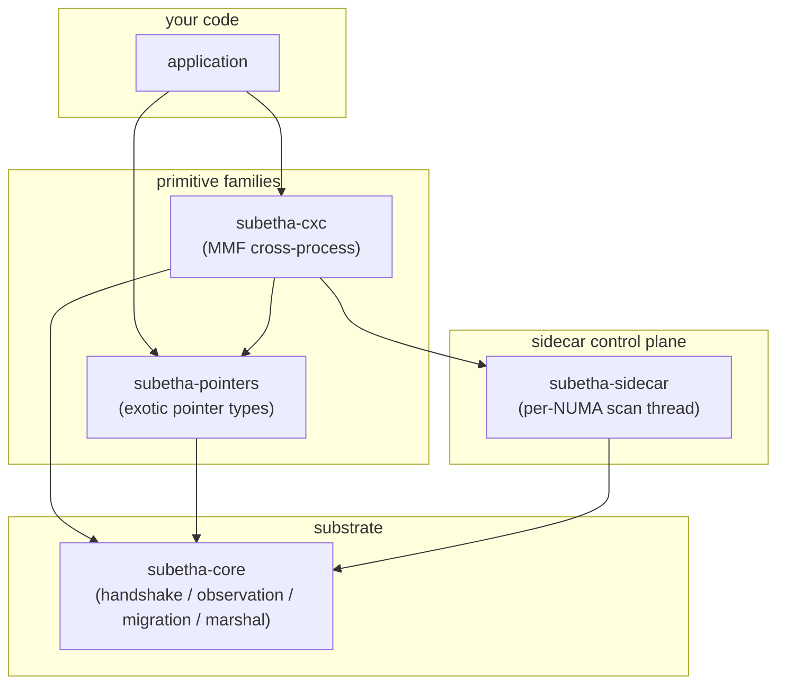

# Architecture

SubEtha is four library crates with one shared substrate. The
`subetha` crate re-exports all four, and three bindings sit on top of
them: `subetha-ffi` for C, `subetha-py` for Python and `subetha-pwrs`
for PowerShell.

## The four crates

Two of the boxes are interesting. The rest are mechanics.

The substrate (`subetha-core`) holds the parts a primitive shares
with the sidecar: a `HandshakeHeader` carrying the strategy tag a
policy sets, an `ObservationRing` for op-stream samples, and a
`migration` protocol a primitive can use to drain in-flight ops
before it frees an old layout. Most CXC primitives carry the first
two. The substrate also defines the `Marshal` trait for "this value
can cross an address-space boundary byte-identically." None of these
starts a thread or schedules work; they are pure data structures.

The control plane (`subetha-sidecar`) is the loop that does the
scheduling. One background thread per NUMA node (nodes are detected
on Windows; elsewhere there is one thread) scans every 200 µs,
drains each registered instance's observation ring, folds it into
`InstanceStats`, and, when the scan drained something, asks the
instance's `Policy` whether to swap strategies. When the policy names
a different strategy, the sidecar calls `apply_migration(new_tag)`
on the instance.

Every `subetha-cxc` primitive registers with `NoMigrationPolicy`, so
for those the sidecar keeps statistics, and a caller's own `Policy`
decides for what the caller registers. The adaptive primitives run
scanners of their own: `AdaptiveRingSidecar`,
`CapacityAdaptiveRingSidecar`, `LocaleAdaptiveRingSidecar`,
`AdaptiveIpcSidecar` and `UnifiedSidecar` each ask a policy on their
own cadence and morph, resize, move or promote their primitive.

## The op path and the scan

The substrate is on the op path. An op on a primitive that carries
an observation ring pushes one observation into it, and while no
sidecar watches any instance in the process, that push is one
relaxed load and a branch.

The sidecar is off the op path. It runs on its own thread, sleeps up
to 200 µs between scans, and updates each instance's stats at most
once per scan. Its scan is an ordinary loop that allocates a fresh
stats snapshot for every instance it drained. None of its work blocks
any op-side thread.

## What `subetha-cxc` ships

CXC is the **Cross-Context Channel**: a typed channel that spans
every execution context users actually have. Cross-thread within
a process. Cross-process on the same machine. Persisted to disk
through the OS page cache. Cross-machine through a QUIC or TCP
bridge at the edge. One byte layout, one API, **no kernel on the
data path** after construction.

The headline type is `Channel<T>`. It and its siblings
`WorkStealQueue<T>` and `KvMap<K, V>` take a declarative workload
shape, a dispatcher names the MMF-backed family that serves it, and
`AutoIpc` infers the shape from hints. The crate holds more than
sixty MMF-backed primitives, among them:

- `SharedRing` for lock-free MPMC streaming.
- The `SharedDeque` family (Chase-Lev plus the SubEtha-native KHL / KHPD /
  LOH / URD variants) for work-stealing.
- `SharedHashMap`, `SharedLRUCache`, `SharedBTreeMap` for keyed
  storage.
- `SharedRWLock`, `SharedSemaphore`, `OwnerLease`, `HeartbeatTable`,
  `EpochBarrier`, `SharedLeaderElection`, `FailoverWatchdog` for
  coordination.

Same MMF, three deployment modes. Map the file from a second
thread and it works cross-thread. Map it from a second process
and it works cross-process. Let the kernel flush dirty pages to
disk and it persists. **There is no separate "shared memory"
abstraction versus a "disk" abstraction. The MMF is both at once.**

## What `subetha-pointers` ships

A kit of exotic pointer types in eight families. Each pairs an
address with extra bits the consumer can act on - skip a deref,
prune a hash bucket, branch on type, validate a bound - without
going through the data. The address is a raw pointer, an `Arc<T>`,
or a 64-bit word with the extra bits packed into it.

- `UmbraPointer<T>` carries a 4-byte content prefix for
  short-circuit equality before deref.
- `BloomPointer<T>` carries a 64-bit Bloom filter for probabilistic
  set membership.
- `CardinalityPointer<T>` carries a log2 cardinality estimate in the
  address's high byte.
- `KStepPointer<T>` encodes a log2 stride for strided iteration.
- `KTower2<T>` / `KTower3<T>` encode multi-segment zone/region/
  offset addresses.
- `SelfDescPointer<T>` carries a type ID and a layout shape in the
  address's high bits, so a heterogeneous container dispatches on a
  byte rather than a vtable.
- `VersionedPointer<T>`, `HlcVersionedPointer<T>` and
  `VectorClockPointer<T, N>` carry a version counter, a hybrid
  logical clock or a vector clock, for MVCC and causal ordering.
- `ReadableCapability<'a, T>` / `WritableCapability<'a, T>` carry
  bounds and permissions checked in software at every access
  (CHERI-style).

None of them implements `Marshal`. Most hold an address that means
something only in the process that made it; `KTower2` and `KTower3`
hold region indices instead, which resolve in any process that holds
the same region tables. `subetha-cxc` uses one piece of the crate,
the `Bloom64` filter, for `AdaptiveIpc`'s record of the batch sizes
it has sent.

## How `send::<u64>` specializes

`AdaptiveIpc::send` carries an in-source
`TypeId::of::<T>() == TypeId::of::<u64>()` branch
([`adaptive_ipc.rs`](https://github.com/Variably-Constant/SubEtha/blob/main/crates/subetha-cxc/src/adaptive_ipc.rs)).
LLVM monomorphizes the comparison to a constant per instantiation
and dead-code-eliminates the unused arm, so the right
specialization is picked at codegen time with no opt-in and no
nightly. The hand-rolled `send_u64` body runs with an 8-byte stack
buffer (not the generic 56-byte `Marshal` payload) so the ring
dispatch sees a concrete known-size payload LLVM inlines directly.
The A/B harness (`benches/adaptive_send_specialized_ab.rs`)
measures the two paths within noise of each other on the current
toolchain - LLVM already inlines the generic `Marshal` path for
`u64` to equivalent code - so the branch's value is the guarantee
of the small-buffer path across toolchains, not a separate
measured win.

## How the boundary is tested

The published crates are gated by `subetha-e2e`, a workspace member
that is not itself published. Each of its scenarios spawns this same
executable through `std::env::current_exe()` as a child role, so the
process boundary under test is a real one rather than two handles to
one file inside a single process - the distinction that decides whether
a cross-process claim has been measured or assumed.

Seven scenarios run: a killed process's in-flight work reclaimed by
the watchdog, ring payloads carried across a boundary and surviving the
writer's death, 25 primitives' `flush_async` state read back from a
second process, a killed peer's replacement session delivered, the same
restart pinned to block Reed-Solomon coding, a replacement receiver
joining a stream in progress, and a `Pass` executed by a worker process
that holds the only handler for its closure id.

## See also

- [Frozen handshakes](frozen-handshake.md) - the thesis the
  architecture serves.
- [Observation pipeline](observation-pipeline.md) - end-to-end
  flow from op push to policy decision.
- [MMF substrate](mmf-substrate.md) - why one byte layout serves
  three deployment modes.
- [`subetha-core` reference](../reference/subetha-core/_index.md) -
  the substrate types in detail.
- [`subetha-sidecar` reference](../reference/subetha-sidecar/_index.md) -
  the control plane in detail.
- [`subetha-cxc` reference](../reference/subetha-cxc/_index.md) -
  the cross-process primitive catalog.
- [`subetha-pointers` reference](../reference/subetha-pointers/_index.md) -
  the exotic pointer kit.
